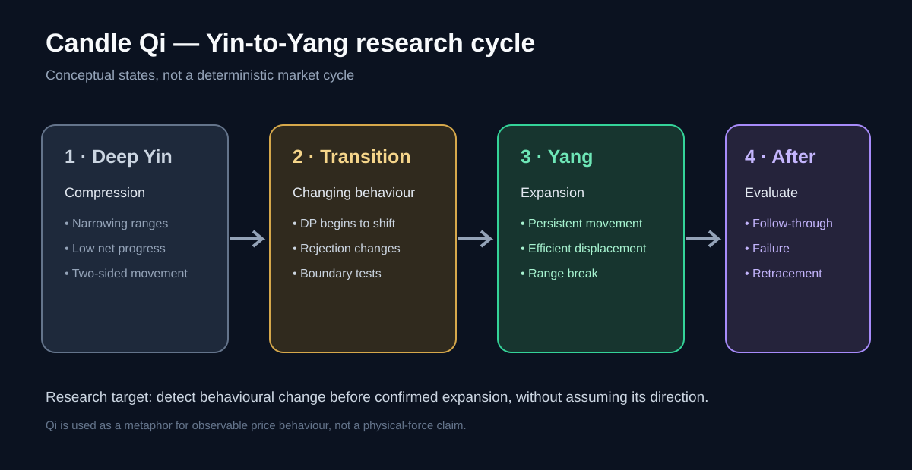
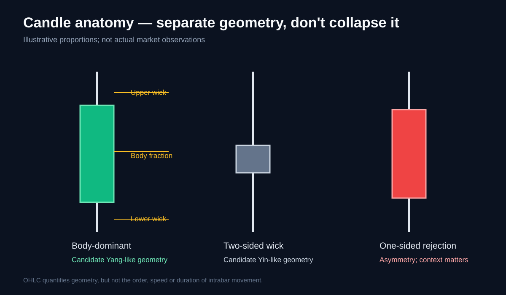
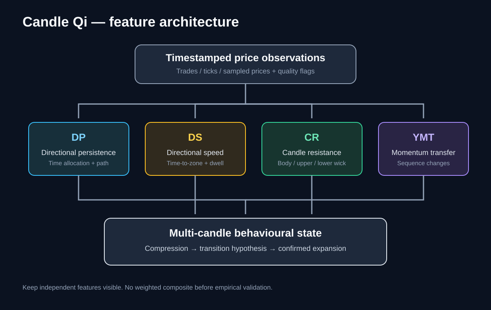

# Candle Qi

**A Price-Action Behavioural Measurement System**

Candle Qi is an open research project exploring whether the *path taken while a candle forms* contains useful information about the transition from quiet price compression to directional expansion.

The central idea is simple:

> OHLC describes the result of a candle. Intrabar price behaviour describes part of the journey.

We want to measure that journey directly from price action—not build another bundle of conventional indicators and rename it.

## Research objective

Develop and validate a candle-level behavioural model that measures:

1. **Directional Persistence (DP):** how much time price spends moving in each direction during a candle.
2. **Directional Speed (DS):** how quickly price approaches and holds near its eventual closing-price region.
3. **Candle Resistance (CR):** how much of the candle's range is represented by the body and by upper/lower rejection wicks.
4. **Yang Momentum Transfer (YMT):** how these characteristics change across successive candles.

The intended application is early identification of conditions that may precede a breakout from a quiet range. The framework must not assume that compression guarantees a breakout, or that candle anatomy alone reveals trader intent.

## Conceptual model

- **Yin-like behaviour:** compression, hesitation, two-sided rejection, low net progress relative to path travelled.
- **Yang-like behaviour:** directional persistence, efficient displacement, rapid movement and limited opposing rejection.
- **Transition:** a change in the behavioural profile across time, potentially before a range expansion becomes obvious.

These are operational metaphors for measurable price behaviour. Qi is not asserted to be a physically measurable market force.

## Start here

- [Research philosophy and hypotheses](docs/01-philosophy-and-hypothesis.md)
- [Candle anatomy and pattern mapping](docs/02-candle-anatomy.md)
- [Directional persistence](docs/03-directional-persistence.md)
- [Directional speed and 7% proximity](docs/04-directional-speed.md)
- [Candle resistance](docs/05-candle-resistance.md)
- [Momentum transfer](docs/06-momentum-transfer.md)
- [Yin-to-Yang transition](docs/07-yin-yang-transition.md)
- [Research and validation plan](docs/08-research-and-validation.md)
- [Development roadmap](development/roadmap.md)
- [References and related research](research/references.md)

## Data principle

A standard 5-minute OHLC candle cannot reveal the order in which its high and low occurred, how many reversals happened, or how long price spent moving in either direction. Those measurements require intrabar observations such as timestamped trades, ticks, or sufficiently fine-grained sampled prices.

The project will keep **OHLC-derived features** separate from **path-derived features**. No algorithm may silently infer unavailable intrabar behaviour from a completed candle.

## Status

**Research specification — not a trading indicator.** No predictive edge or profitability is claimed. Definitions, thresholds and hypotheses remain subject to empirical testing.

## Illustrative diagrams

## License

MIT. See [LICENSE](LICENSE).
