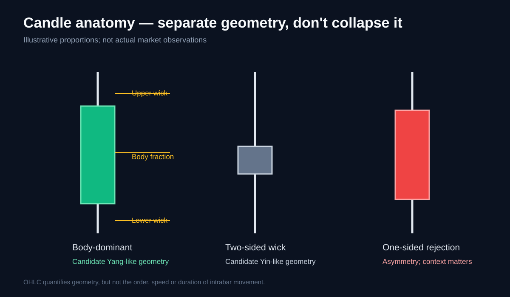

# 2. Candle anatomy and traditional pattern mapping

Traditional Japanese candlestick patterns are useful visual descriptions. Candle Qi treats them as starting observations, not fixed buy/sell instructions.

## OHLC geometry

For a candle with open O, high H, low L and close C, where H > L:

- Range: R = H - L
- Body: B = |C - O|
- Upper wick: U = H - max(O, C)
- Lower wick: Lw = min(O, C) - L

Normalize by range:

- Body fraction b = B / R
- Upper-wick fraction u = U / R
- Lower-wick fraction l = Lw / R

For a valid candle, b + u + l = 1, subject to floating-point precision. If H = L, ratios are undefined and must be handled explicitly.

## Pattern-to-behaviour hypotheses

| Traditional pattern | Geometric observation | Candle Qi interpretation to test |
|---|---|---|
| Marubozu | Large body, tiny wicks | High body dominance; candidate Yang-like anatomy |
| Doji | Tiny body, often extended wicks | Low net displacement; candidate Yin-like result |
| Spinning top | Small body and two meaningful wicks | Two-sided rejection / conflict |
| Hammer | Small body, long lower wick | Downside rejection; depends on location and path |
| Hanging man | Hammer-like anatomy after an advance | Same geometry, different context |
| Shooting star | Small body, long upper wick | Upside rejection; context-dependent |
| Inverted hammer | Similar upper-wick geometry in a decline | Potential rejection; context-dependent |
| Engulfing | Current body covers prior body | Possible change in relative candle-body dominance |
| Inside bar | Current range lies within prior range | Range contraction / containment |
| Outside bar | Current range exceeds prior range | Range expansion; direction needs separate analysis |

## Why shape is not enough

Two candles may have identical OHLC values but very different intrabar paths: one may travel smoothly from open to close, while another reverses repeatedly before ending at the same close.

OHLC cannot distinguish these paths. Candle Qi must not pretend that body/wick geometry measures time spent moving in a direction.

## Context matters

A hammer-shaped candle near a range low and the same geometry near a range high should not automatically receive the same interpretation. First isolate intrinsic candle behaviour from location/context effects.

All classifications are hypotheses for testing, not validated standalone signals.
