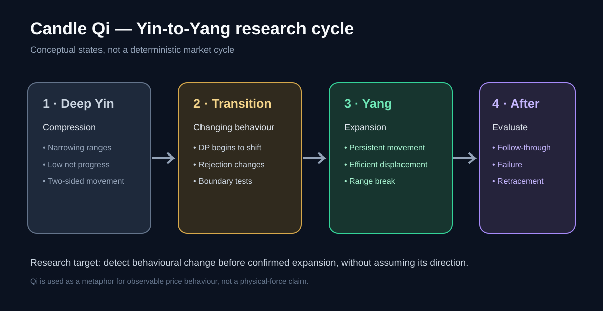

# 7. Yin-to-Yang transition model

## Conceptual stages

1. **Deep Yin / compression:** range and movement contract; candle behaviour may show low net progress and repeated reversals.
2. **Transition / changing pressure:** intrabar persistence, close-region behaviour, wick asymmetry or repeated boundary tests change.
3. **Yang / expansion:** price makes a larger-than-usual move beyond a previously defined range.
4. **Post-expansion:** measure continuation, failure, retracement and volatility decay.

These are descriptive research states, not a deterministic cycle. Markets can remain compressed for a long time or expand without a clean precursor.

## Separate event detection from direction prediction

A. **Expansion event:** Does a meaningful range/volatility expansion occur within horizon h?

B. **Direction:** Conditional on expansion, does price break upward or downward relative to a range defined before the event?

A model may predict expansion without predicting direction. That is a valid outcome, not a failure.

## Define the event without leakage

At decision time t, define a prior range using only past observations, for example high/low over a fixed lookback ending at t. Define expansion thresholds using training data or a rolling historical distribution.

Potential outcome labels:
- breakout_up: price exceeds prior range high by a pre-defined buffer within horizon h;
- breakout_down: price falls below prior range low by a pre-defined buffer within h;
- expansion_no_direction: realized range expands but no clean boundary break occurs;
- no_expansion: neither event occurs within h.

Thresholds are experimental parameters, not recommended trading defaults.

## Candidate model

Keep a transparent feature panel:
- compression persistence from candle ranges and path lengths;
- DP and path efficiency;
- DS7 retrospectively for analysis only;
- live-safe speed features separately;
- body and wick geometry;
- YMT deltas across a defined sequence;
- prior-range distance and boundary-test count.

Start with interpretable regression or tree-based baselines only after feature definitions are stable. Compare against simple baselines, such as historical expansion frequency and range-based features.

## Non-negotiable safeguards

- Features must be timestamp-aligned and available at prediction time.
- Train/test splits must be chronological.
- Avoid overlapping-label leakage in validation.
- Use walk-forward evaluation.
- Evaluate across assets, regimes and timeframes.
- Include spreads, fees, slippage and realistic execution delays for strategy tests.
